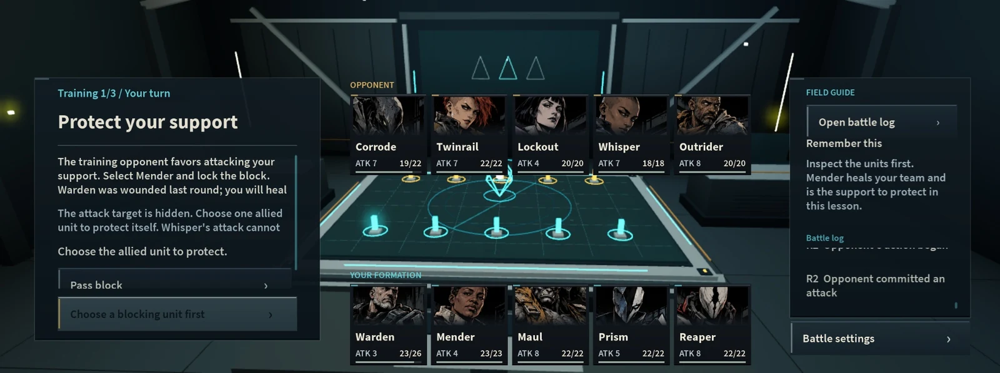

# 先攻 / FIRST MOVE

Roblox 双人回合制策略游戏：十二位角色池，双方各选五人；通过能核暗选、攻击目标、格挡判断和角色能力争夺主动权。五人指每方出战角色数，不是五名玩家。



## 打开与构建

1. Roblox Studio → Open from File → `roblox/DEADLOCK_PROTOCOL.rbxlx`。这是本包当前主工程。
2. 单人测试使用 AI；双人开发测试使用 Server & Clients，启动两名客户端，两边都选择双人模式。同服配对，不是跨服务器匹配。
3. 修改 `roblox/src/` 后，在仓库根目录运行 `node roblox/build.cjs` 或 `npm run build`。不需要 npm install；构建只使用 Node 内置模块。
4. 重新从磁盘打开生成的工程，避免旧 Studio 窗口覆盖它。构建备份仅写入本仓库 `.build/backups/`。

## 结构

- `roblox/src/shared/`：核心配置、AI 与成长配置。
- `roblox/src/server/`：服务器权威规则、隐藏信息投影、对局服务与版本化存档。
- `roblox/src/client/`：人物卡、界面、语言、战报、音效、镜头与结算反馈。
- `roblox/tests/`：Studio 开发检查脚本，不嵌入正式工程。
- `roblox/assets/`：已采用的十二位角色图、段位和发布素材。
- `docs/`：实机画面、音源说明与验证界限。
- `generated/`：构建清单输出。

## 当前版本

桌面好友试玩已上传：[Roblox FIRST MOVE](https://www.roblox.com/games/84039214756325/FIRST-MOVE)。中英双语、AI、同服 PvP、日志、战报、教程和成长档案已有实现。

开发阶段双客户端完整对战、再战与镜像战报已验证，玩家反馈正式服可游玩；双真实账号正式服完整对战与云存档重进尚未独立验收。此源码包整理不新增游戏实测结论。

已有图像／音频 ID 可能受 Roblox 体验归属和资产权限限制。复制工程到另一账号时需重新核对或上传自己的资产；不要认为随包原始 PNG 会自动更换云端 ID。

## 上传 GitHub

解压本项目的 ZIP。把解压后的文件和目录作为仓库内容上传，README.md 应在仓库根目录；不要只上传 ZIP 本身。项目之间分别建仓库。

也可以在解压目录打开终端执行（将 REPOSITORY_URL 替换成自己的 GitHub 仓库地址）：

```sh
git init
git add .
git commit -m "Initial project source"
git branch -M main
git remote add origin REPOSITORY_URL
git push -u origin main
```

这些步骤需要你自己的 GitHub 账号和仓库；本包没有账号令牌或自动发布脚本。
